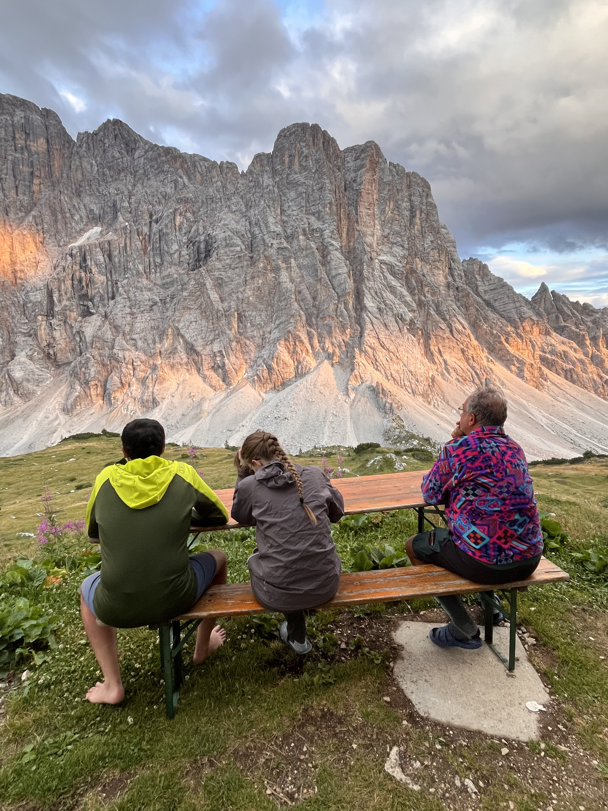

# The Civetta-Moiazza Ring

After hiking [Alta Via 2](../av2), I wanted to try another multi-day
hike the following year. This time I decided to come up with a route
by myself, and to make it more accessible so that I could invite
more friends.

The result is a 3 day ring tour of the
[Civetta](https://en.wikipedia.org/wiki/Monte_Civetta)-Moiazza
mountain group, in the heart of the Dolomites.

This hike does not require advanced mountaineering skills, but
nonetheless it gives one access to some of the most beautiful landscapes
of the world. Check out these pages if you don't belive me!

* [Planning](planning)
* [Day 1 - To the north-west wall](day1)
* [Day 2 - Dodging the storm](day2)
* [Day 3 - Wading through the woods](day3)
