<table style="width: 100%; table-layout: fixed;"> <thead> <tr>
	<th style="text-align: left"> <a href="../planning">← Planning</a> </th>
	<th style="text-align: center"> <a href="../">Civetta-Moiazza Tour</a> </th>
	<th style="text-align: right"> <a href="../day2">Day 2 →</a> </th>
</tr> </thead> </table>

# Day 1 - To the north-west wall

<em>August 7, 2026</em>

## Route of the day

<strong>Click to see map</strong>

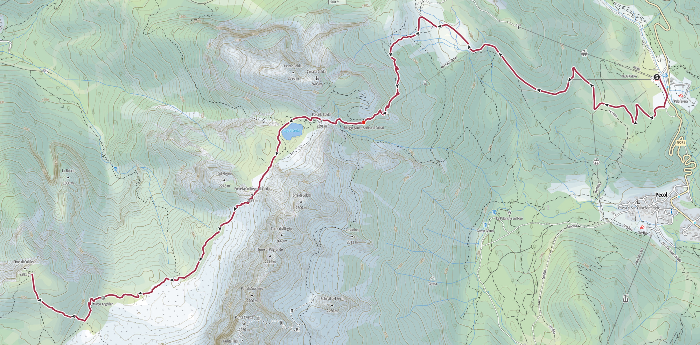

*Download the [gpx file](../gpx/civetta-moiazza-day1.gpx) or see the
route on
[outdooractive.com](https://www.outdooractive.com/en/route/hiking-trail/belluno/tour-civetta-moiazza-day-1/332670819/?share=%7E33cisp7g%244ossme4d)
or on
[Garmin Connect](https://connect.garmin.com/app/activity/23886687005).*

## An easy walk to Rifugio Coldai

Our journey starts at around 9:00 fom Palafavèra (1514m on sea level).
We walk up an easy dirt road (trail 564), with a beautiful view on
[Monte Pelmo](https://en.wikipedia.org/wiki/Monte_Pelmo) behind us.

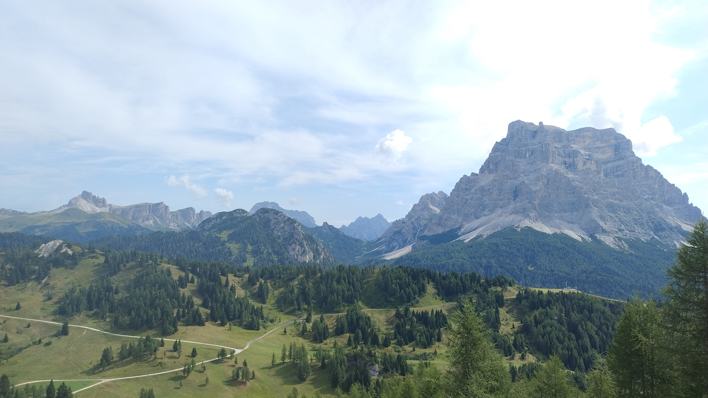

<em>Monte Pelmo.</em>

We are worried about the weather, as strong thunderstorms are
possible in the afternoon. But are walking at a good pace, as we
reach Casera Pioda (1819m) after around one hour.
In the meantime, the view has opened up on the south, showing us
mountains that I couldn't name.

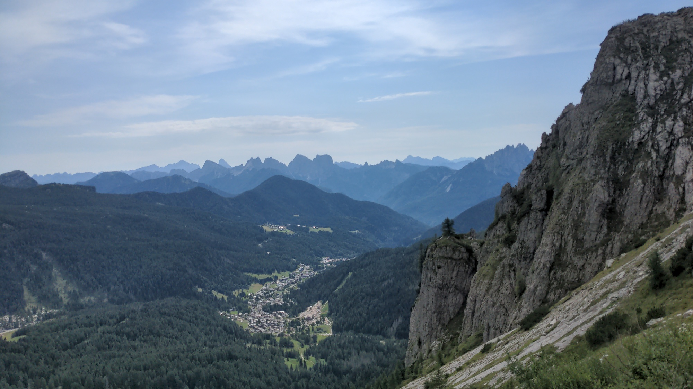

<em>
The view on the south, with the small village of Pécol in the foreground.
</em>

We continue on trail 564 and then take trail 556.
After another hour, at around 11:00 we reach Rifugio Coldai (2180m),
where we stop to eat our usual slice of
*[Apfelstrudel](https://en.wikipedia.org/wiki/Apple_strudel)*
- but some of us prefer
*[Sachertorte](https://en.wikipedia.org/wiki/Sachertorte).*

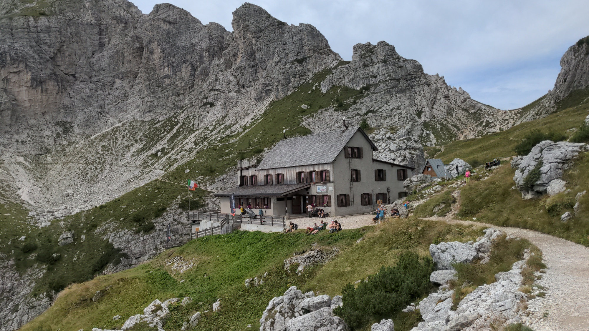

<em>Rifugio Coldai.</em>

## On to Rifugio Tissi

We leave the hut at 11:45, and soon we reach Lake Coldai (2140m).
We are now turning around the northern side of Monte Civetta. Pelmo,
on the north-east, hides behind the rocks we have just passed, while
new mountains become visible on the north.

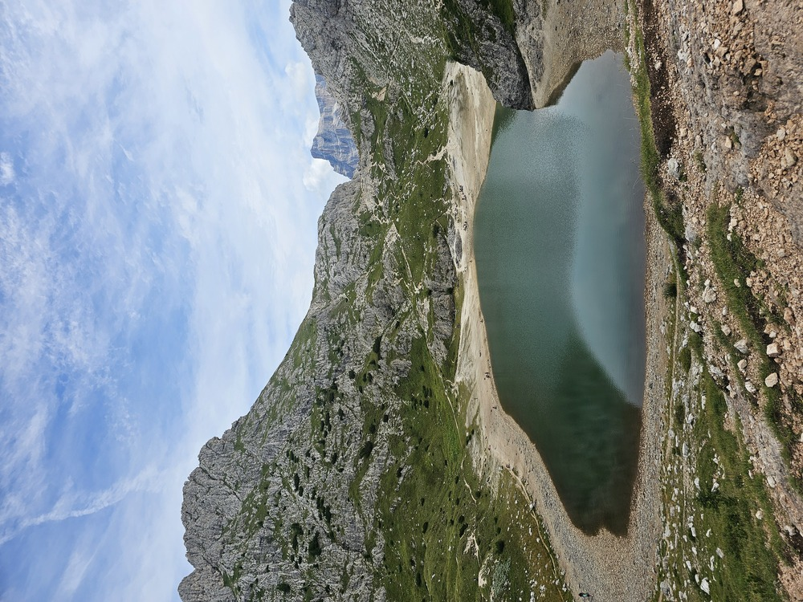

<em>
Lake Coldai, and Monte Pelmo peeking out from behing the rocks.
</em>

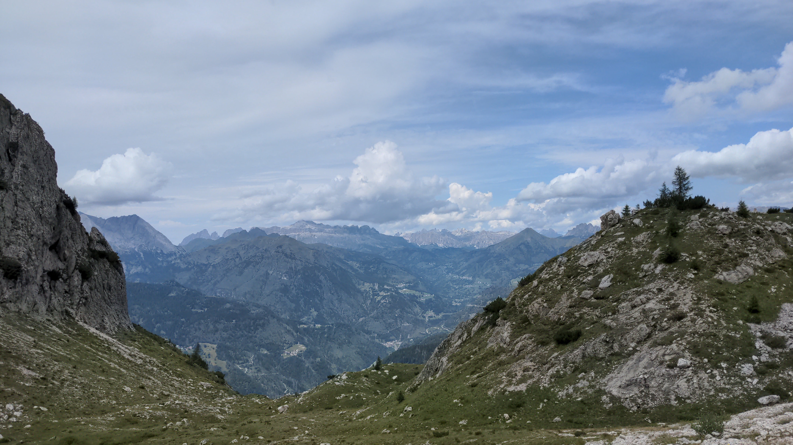

<em>
The mountains visible on the north. Can you spot the
<a href="https://en.wikipedia.org/wiki/Tre_Cime_di_Lavaredo">
Tre Cime di Lavaredo</a>?
Try with the <a href="../img/7-1227-north.jpg">full-size picture</a>!
</em>

Moving towards Rifugio Tissi, we walk down along trail 560 to
around 2000m of altitude, where the downward trail 565 starts.
Here, at 13:15, we take a small break with a beatiful view on the
peaks of northern [Agordino](https://en.wikipedia.org/wiki/Agordo).

After a steep, but short, ascent along trail 563 we
reach rifugio Tissi (2250m) at 14:25.

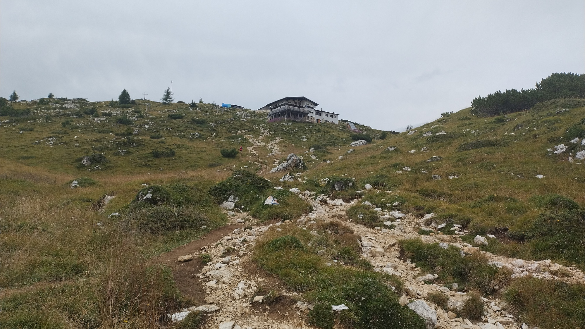

<em>Rifugio Tissi.</em>

## A relaxing afternoon

Arriving so early at our destination for the day means we have
a lot of time to relax, and to enjoy the beautiful scenery from
the summit of Col de Reàn (2281m), which is just behind the Rifugio.

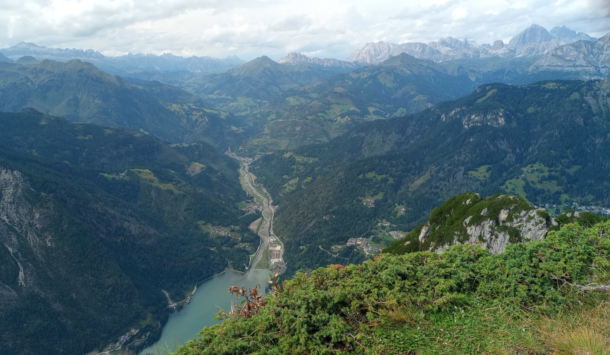

These pictures do not show it well, but the northern side of Col
de Reàn drops vertically down to the Alleghe Lake (1000m).
The drop is almost 1300 meters!

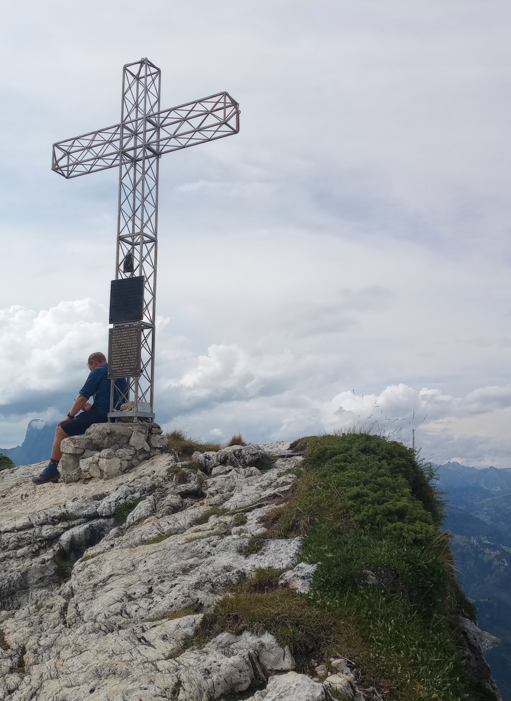

<em>
The summit of Col de Reàn. You can see the drop on the right
edge of the mountain.
</em>

Due to the ongoing drought, it is not possible to shower - and
in fact there is little water from the tap, so even washing
one's hands is quite challenging.

More on the bright side, the expected thunderstorm does not
happen, so we can enjoy more time outside after dinner.

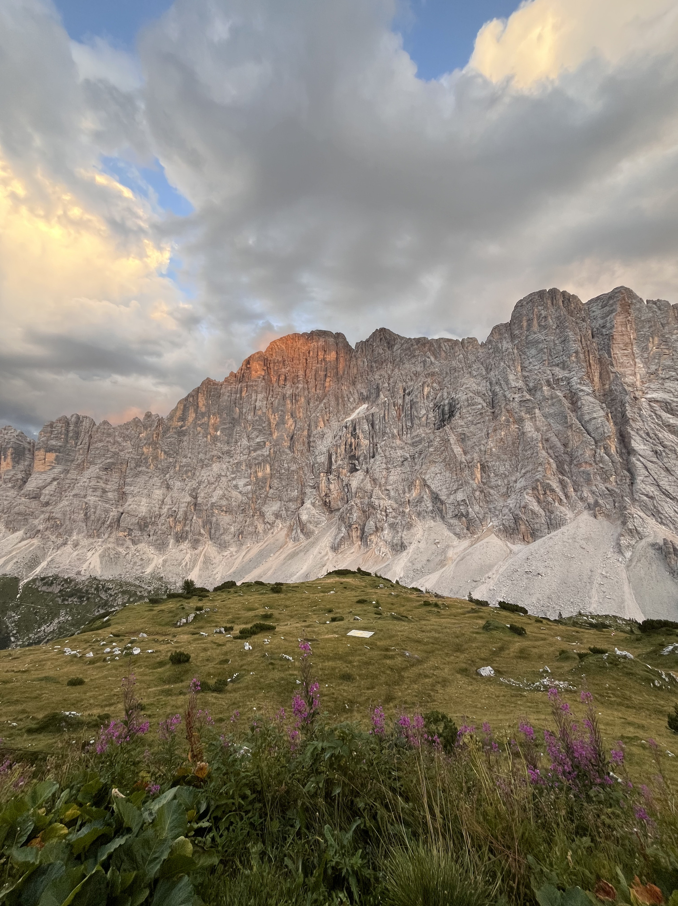

<em>The north-west face of Civetta.</em>

Around sunset, we manage to catch a brief glimpse of an intense
*enrosadira* - or [alpenglow](https://en.wikipedia.org/wiki/Alpenglow).

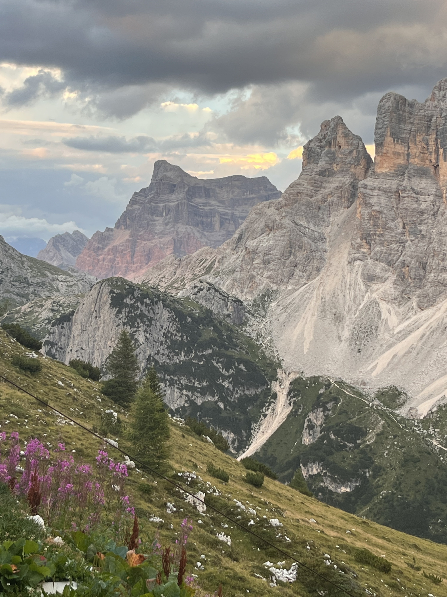

<em>
The base of Monte Pelmo was briefly an intense pink hue, almost
purple. This is shot does not show the phenomenon at its peak,
but it is the best we have.
</em>

<table style="width: 100%; table-layout: fixed;"> <thead> <tr>
	<th style="text-align: left"> <a href="../planning">← Planning</a> </th>
	<th style="text-align: center"> <a href="../">Civetta-Moiazza Tour</a> </th>
	<th style="text-align: right"> <a href="../day2">Day 2 →</a> </th>
</tr> </thead> </table>
