<table style="width: 100%; table-layout: fixed;"> <thead> <tr>
	<th style="text-align: left"> <a href="../day1">← Day 1</a> </th>
	<th style="text-align: center"> <a href="../">Civetta-Moiazza Tour</a> </th>
	<th style="text-align: right"> <a href="../day3">Day 3 →</a> </th>
</tr> </thead> </table>

# Day 2 - Dodging the storm

<em>August 8, 2026</em>

## Route of the day

<strong>Click to see map</strong>

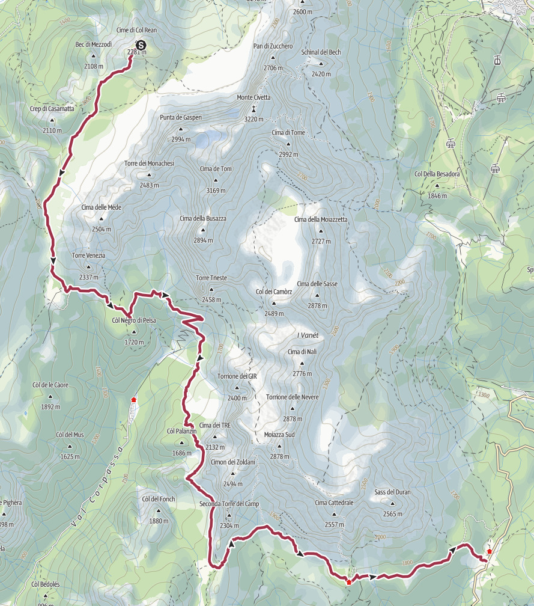

*Download the [gpx file](../gpx/civetta-moiazza-day2.gpx) or see the
route on [outdooractive.com](https://www.outdooractive.com/en/route/hiking-trail/belluno/tour-civetta-moiazza-day-2/332670918/?share=%7E33ci7ygn%244ossme4d)
or on
[Garmin Connect](https://connect.garmin.com/app/activity/23903150233).*

## Down to Rifugio Vazzolèr

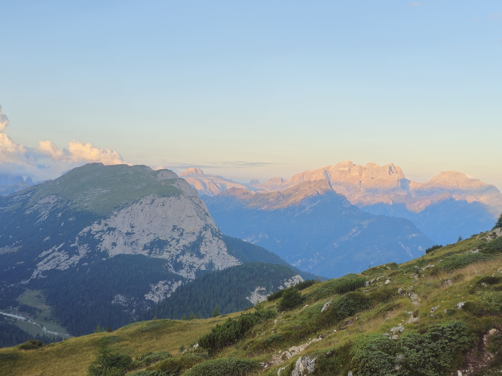

<em>
The dawn from Rifugio Tissi, looking south-west towards Agordo.
</em>

We leave Rifugio Tissi at 7:45, headed to Rifugio Vazzolèr. There
are two trails to get there, we pick 560 over 563. The route is
clearly indicated by the Alta Via 1 marks.

After about one hour we reach a nice green meadow at 1900 meters
on sea level.

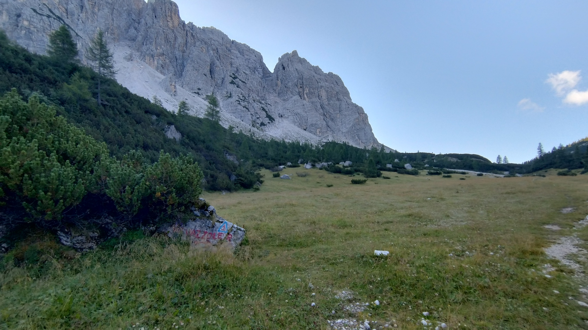

<em>
The meadow, with the southern end of the Civetta on the
center-left. On a rock in the foreground you can see a blue
triangle with a "1" in it - a mark for Alta Via 1.
</em>

It looks like the ideal spot for camping, and indeed later in the
day we would meet a group of scouts who planned to pitch their
tents here.

After a short break we start walking again, and at around 10:00 we reach
Rifugio Vazzolèr. This place is almost like a small village, with a few
separate buildings and even a small church and a little botanical garden.

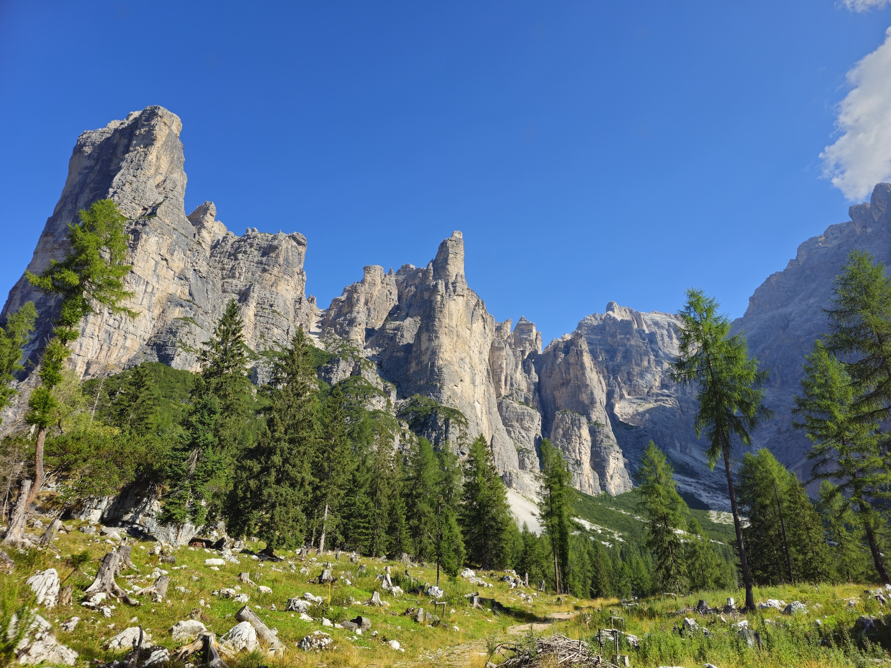

<em>
Around the latitude of Rifugio Vazzolèr, we leave the Civetta group
to enter the <a href="https://it.wikipedia.org/wiki/Moiazza">Moiazza</a>
group. I believe this picture shows the divide between the two, but
it is not very clear to me where one ends and the other begins.
Effectively, they form one mountain group.
</em>

We sit down, drink some water with
[elderberry](https://en.wikipedia.org/wiki/Sambucus) syrup,
and we are ready to start walking again at 10:35.

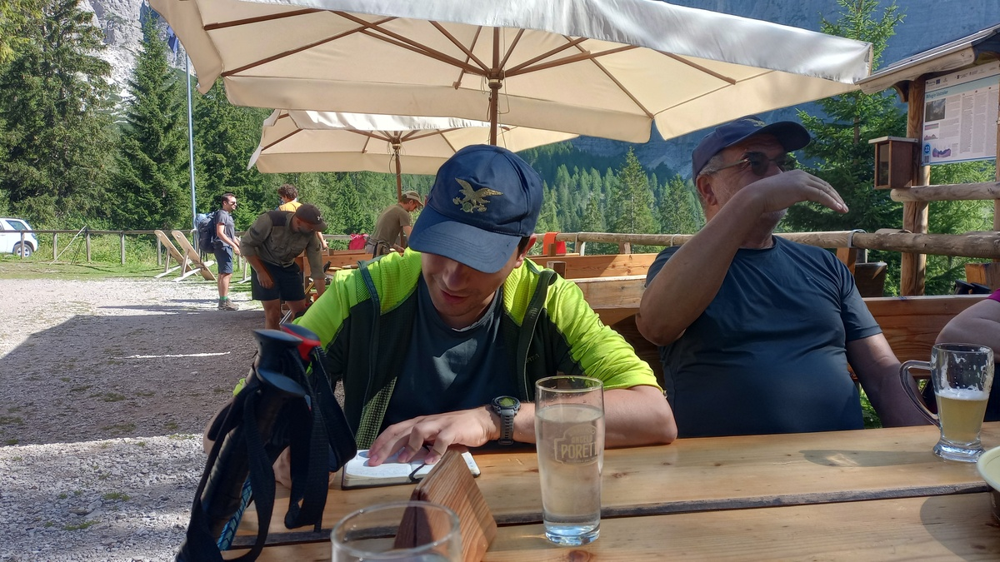

## Running from the storm

From Rifugio Vazzolèr we walk down a dirt road (trail 555) until around
11:15, when we reach the junction with trail 554, at 1430m. After a short
break we take this other trail, which gradually becomes more technical,
but never hard or steep - in fact, we neither gain nor loose altitude.

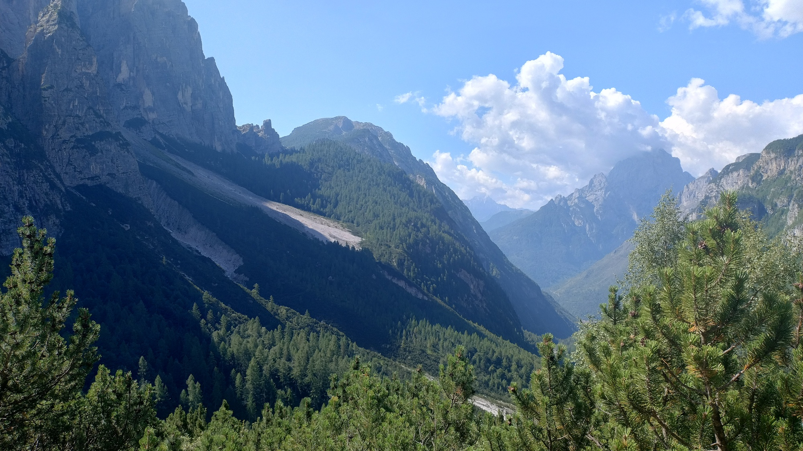

At 11:50 we stop for about 20 minutes to eat something.
Now the trail begins to go up, but it is still not too steep.

After another short break next to *Col Palanzìn* (1700m), the trail
becomes more steep. We reach the pass of *Col de l'Ors* (1800m) at 13:25.
This is perhaps the most difficult section of the hike, and we
all make it through without issues.

We now see another pass very far away, and we worry that it is
*Forcella del Camp*, the next pass we have to reach.

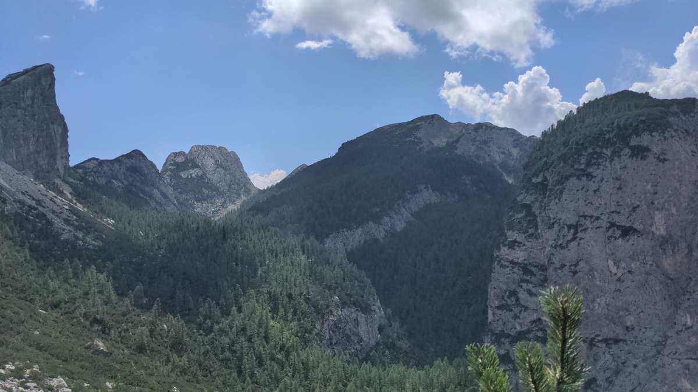

<em>
In the center-left of this picture, a far away pass.
</em>

Luckily, that was instead *Forcella di Sejère*, but we only realize
this at 14:30, when we reach a crossroad (1880m) and we finally see
*Forcella del Camp* on our left. The last 50 meters to reach it are
quite steep, but we are relieved to see it much closer than we
previously thought.

After a 15 minutes snack break, we walk up, we take some pictures,
and then we walk down towards Rifugio Carestiato.

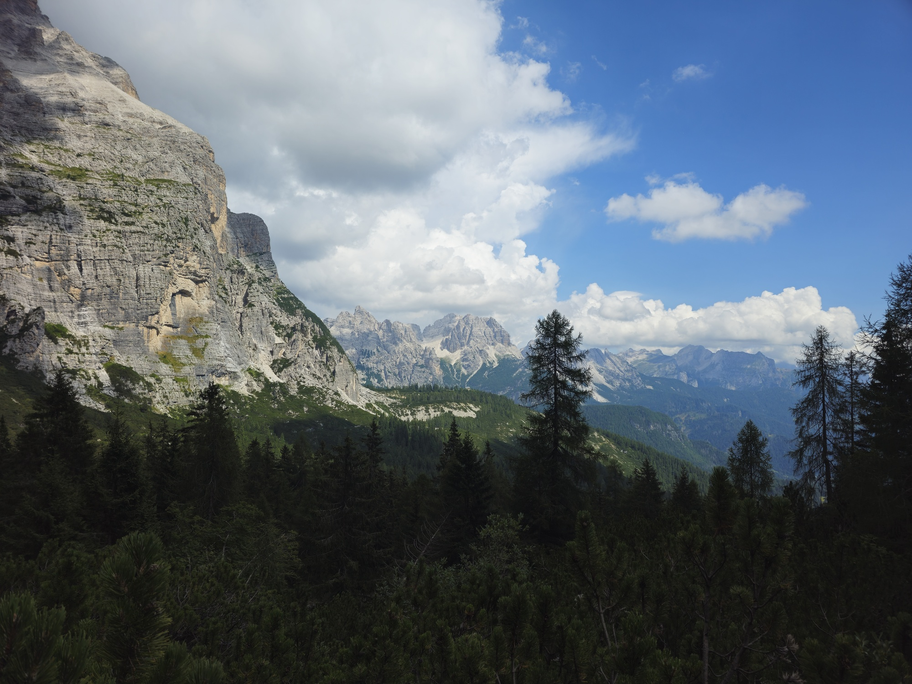

<em>
The view from Forcella del Camp towards
<a href="https://en.wikipedia.org/wiki/Val_di_Zoldo">Zoldo</a>, the
valley where we started our journey (and where we are going to end it).
</em>

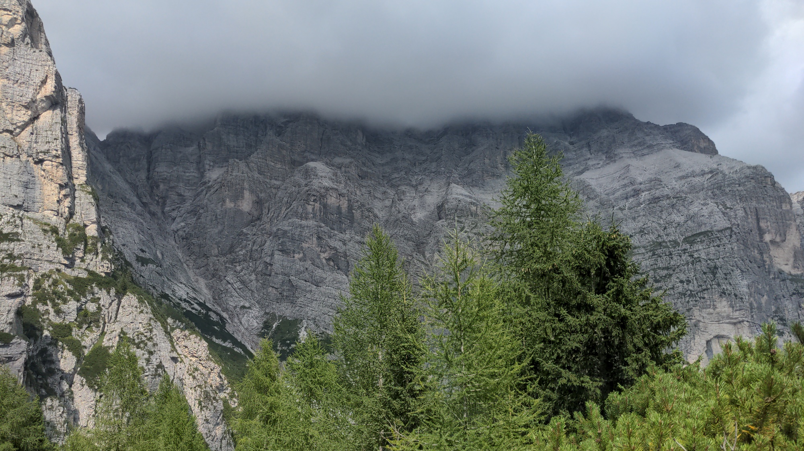

<em>These clouds don't look promising...</em>

At this point we are facing some menacing clouds, and we can hear thunders.
We feel the first drops of rain, and we try to rush our way to the hut.
For this reason, we don't have many pictures of this section.

Some of us are faster, some are slower. The fastest of our group manage to
reach Rifugio Carestiato (1850m) at around 16:00, just as the storm begins.
The rest of us get there soaked, some more than others.

## Slippery when wet

The storm is very strong, but also quick. We barely have time to order
a [radler](https://en.wikipedia.org/wiki/Shandy#Radler) and drink it.
We don't want to linger here for too long, as we still have about one
hour before we reach our final destination for the day. We leave
Rifugio Carestiato at 16:55.

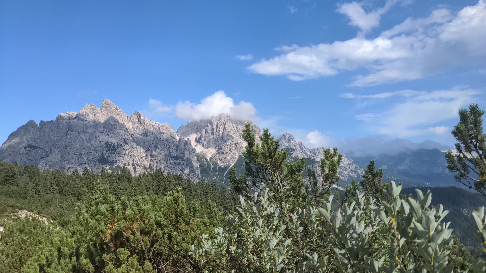

<em>
The view after leaving Rifugio Carestiato, just a few minutes
after the storm has ended.
</em>

As we are all a bit tired from the long day, we walk down slowly.
Some parts of the road had become rivers during the storm, and
are still draining. The steep last part before the Duràn pass
is also quite slippery, but we manage not to fall.

We finally arrive at the pass at 17:50. The place is not as
beautiful as the location of Rifugio Tissi, but at least here we
can eat, have a shower, and sleep.

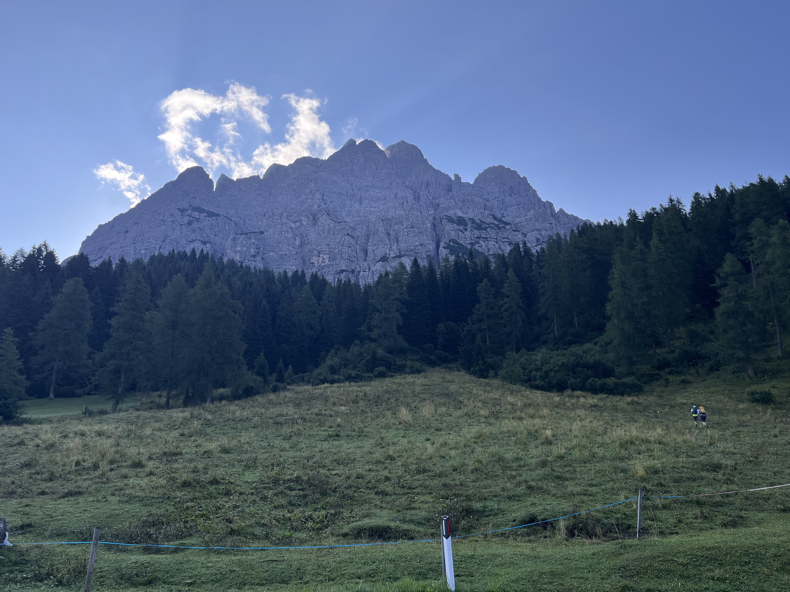

<em>
Cima di San Sebastiano, part of the Tamèr group, seen from
the Duràn pass.
</em>

<table style="width: 100%; table-layout: fixed;"> <thead> <tr>
	<th style="text-align: left"> <a href="../day1">← Day 1</a> </th>
	<th style="text-align: center"> <a href="../">Civetta-Moiazza Tour</a> </th>
	<th style="text-align: right"> <a href="../day3">Day 3 →</a> </th>
</tr> </thead> </table>
