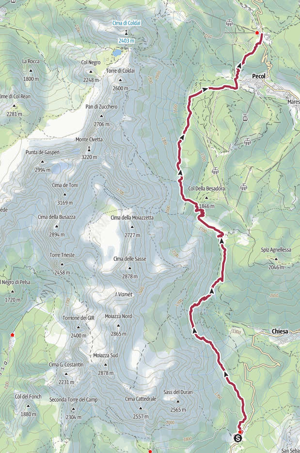
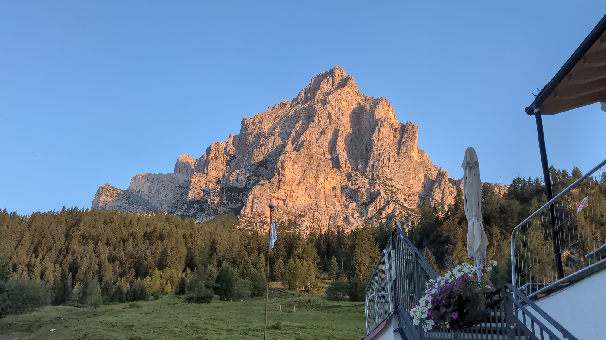
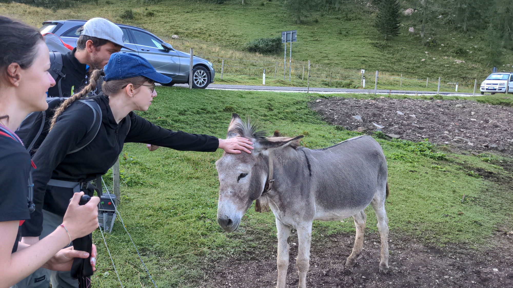
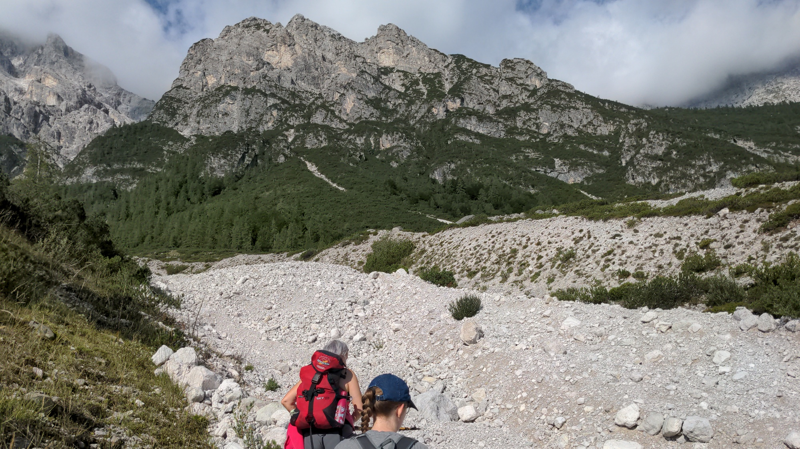
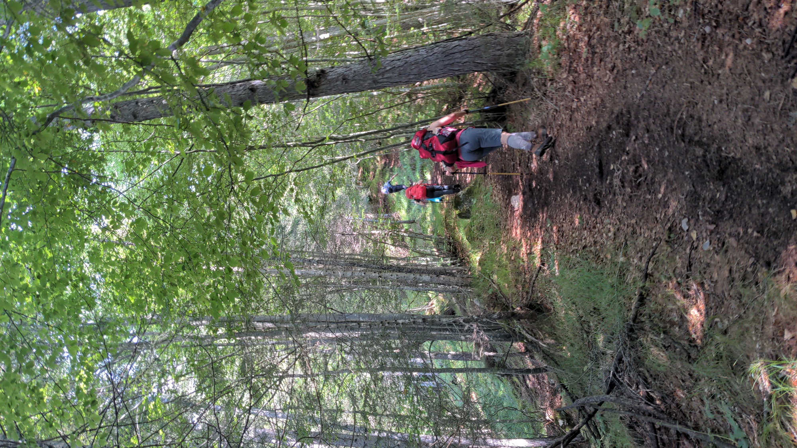
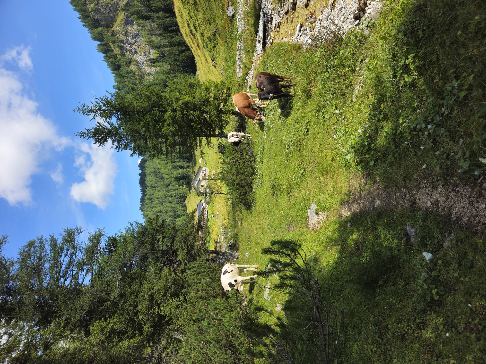
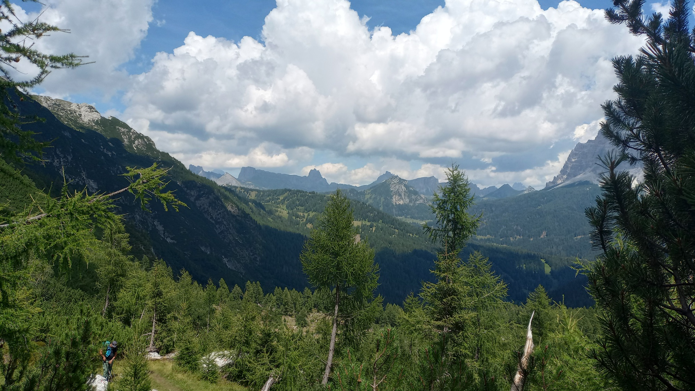
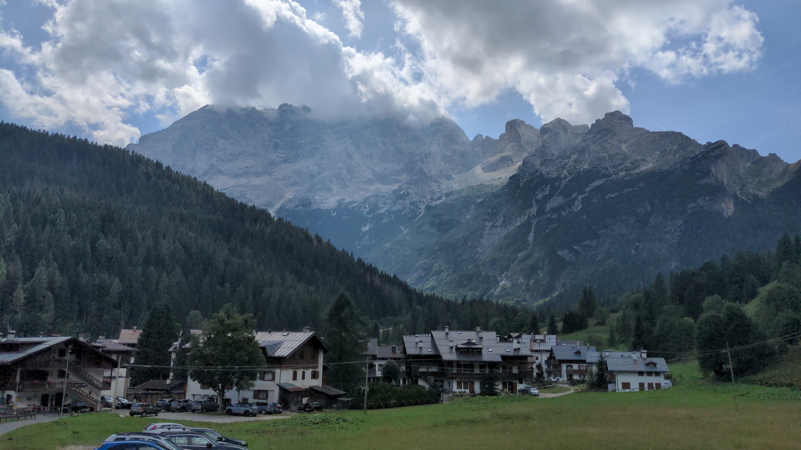
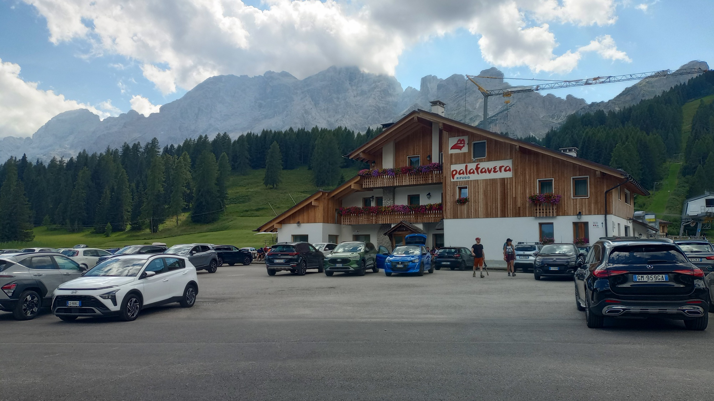

<table style="width: 100%; table-layout: fixed;"> <thead> <tr>
	<th style="text-align: left"> <a href="../day2">← Day 2</a> </th>
	<th style="text-align: center"> <a href="../">Civetta-Moiazza Tour</a> </th>
	<th style="text-align: right">  </th>
</tr> </thead> </table>

# Day 3 - Wading through the woods

<em>August 9, 2026</em>

## Route of the day

<strong>Click to see map</strong>

*Download the [gpx file](../gpx/civetta-moiazza-day3.gpx) or see the
route on [outdooractive.com](https://www.outdooractive.com/en/route/hiking-trail/belluno/tour-civetta-moiazza-day-3/332670975/?share=%7E33ci9nwt%244ossme4e)
or on [Garmin Connect](https://connect.garmin.com/app/activity/23911892135).*

## Planning the route

Today is the final day of the tour, the day we close the loop by
walking up the Zoldo Valley, back to Palafavèra. This area is very
popular in winter, for skiing, but less popular among hikers, at
least compared to the trails we walked the previous two days.

Unlike the first two days, when we simply followed the route for
Alta Via 1, this time we had to choose the path on our own. We did
this in advance, of course. But there were multiple ways to complete
our tour, and none stood out as the best one, so we changed our
plan multiple times before agreeing on a final one.

In the end, we chose to avoid all difficult trails (marked
as EEA, which stands for *experienced hikers with equipment*) and
took a lower path, mostly in the forest. The more adventurous hiker
may want to try the higher *Sentiero Angelini*, but keep in mind
that considerable hiking experience may be required; you should
also avoid it if you are afraid of heights.

The gpx file that you can download from the link above, as well
as the Garmin Connect link, report the route we took. The other
website shows an earlier version of the plan, which should have
a little difficult section somewhere - although these details are
clearly marked only on [Tabacco
maps](https://https://www.tabaccoeditrice.it), the gold standard
for hikers.

With this preamble out of the way, we can get back to our journey!

## The forest trail

<em>
The Moiazza at dawn, from Rifugio Passo Duràn.
</em>

We leave Rifugio Passo Duràn at 8:00, not before we pet the donkeys.

We walk a hundred meters or so on the main road and then turn left
at Rifugio San Sebastiano, the other hut in the area. We take trail
578, going from meadow to forest.

Here we have to focus to take the correct trail, as there are many
tracks that lead more or less in the same direction. At 8:45 we are
at a crossroads, and we take the right on what I believe is another
branch of trail 578 (not the one marked as *Sentiero Angelini*).
The trail goes down steeply. Shortly afterwards we turn left, on an
unnumbered trail, marked with a dashed black line on our map.

<em>
Around 9:15 we are briefly out of the forest, and we walk
past this picturesque
<a href="https://en.wikipedia.org/wiki/Couloir">couloir</a>.
</em>

At 9:25 we reach an abandoned football field at 1290 meters on sea
level, which now is more likely used as an
[apiary](https://en.wikipedia.org/wiki/Apiary). This is the lowest
altitude we reach in the whole tour.

We now take a narrow trail that goes up in the woods. Soon it becomes
extremely steep.

This trail is called *Triol dei brusolai*, acoording to our maps,
which in the local dialect should mean something like "trail of
the roasted ones". No idea why.

<em>Triol dei Brusolai.</em>

At 10:15, after an exhausting uphill walk, we are back to trail 578,
which we follow again next. Along this path there are plenty of wild
strawberries and raspberries, and we eat a bunch of them.

At 11:00 we reach *Casera de la Grava* (1627m). We were hoping we could
buy some food here, but the place is privately owned, they don't
sell anything. So we walk past it, looking for a spot where we can
sit down and eat our protein bars; we find it at 11:30.

<em>
Casera de la Grava, and some cows in the foreground.
</em>

We get up and leave at 11:55, headed to *Forcella de la Grava*
(1784m), which we reach in about 20 minutes. From here we take
trail 557 and then trail 587, slowly going up to *Col de la
Grava* (1900m). This is the highest point we will reach today,
and there is a nice view on the Zoldo Dolomites.

Soon afterwards the path start going downhill. We follow it until
it becomes a dirt road (marked as trail 586), and we reach Pécol
(1400m) at 14:25.

## The last stretch

The journey is almost over now. Before walking back up to our cars,
we decide to enjoy a longer break. We order a couple of radlers at
a local bar.

<em>
Pécol, with the Civetta in the background.
</em>

At 15:00 we leave Pécol. The trail to Palafavèra is right next
to the main road, not the most scenic of trails. But we need to
get back to our cars, and all alternatives are at least a couple
of hours longer.

We arrive at Palafavèra, tired but satisfied, at 15:40.

<em>
Rifugio Palafavèra with the Civetta in the background.
</em>

And this concludes our journey! Definitely more accessible and
less painful than [last year's 9-day adventure](../../av2),
but a beautiful trip nonetheless.

<table style="width: 100%; table-layout: fixed;"> <thead> <tr>
	<th style="text-align: left"> <a href="../day2">← Day 2</a> </th>
	<th style="text-align: center"> <a href="../">Civetta-Moiazza Tour</a> </th>
	<th style="text-align: right">  </th>
</tr> </thead> </table>
