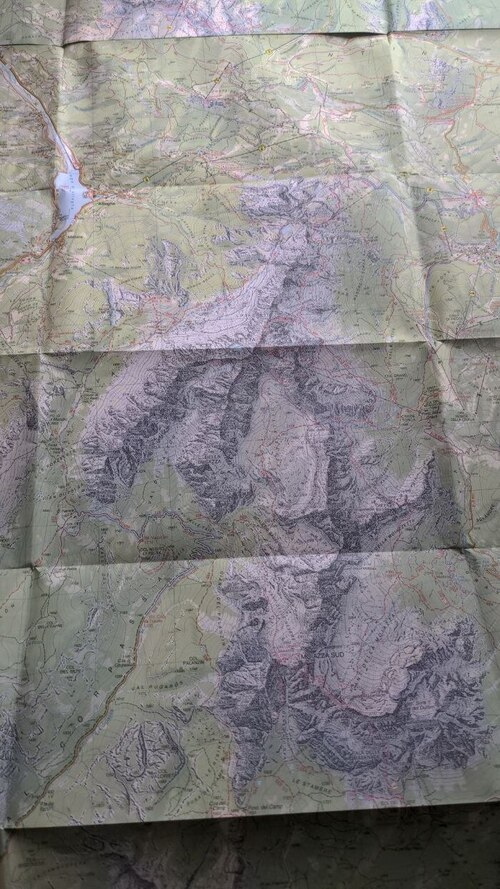
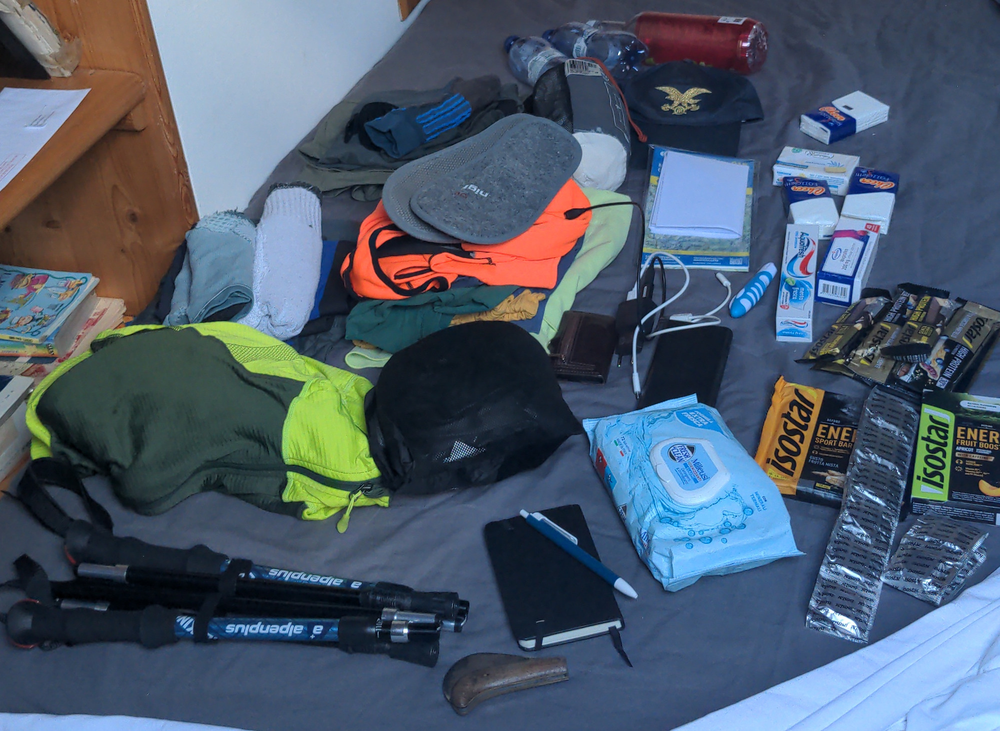

<table style="width: 100%; table-layout: fixed;"> <thead> <tr>
        <th style="text-align: left">  </th>
        <th style="text-align: center"> <a href="../">Civetta-Moiazza Tour</a> </th>
        <th style="text-align: right"> <a href="../day1">Day 1 →</a> </th>
</tr> </thead> </table>

# The Civetta-Moiazza Ring

## The route

To get an experience similar to [Alta Via 2](../../av2), but with less
the pain, I thought of a 3-day course, avoiding hard and technical
trails so that I could invite less-trained friends. This is the result:

||Start|Finish|Up|Down|Distance|
|:-|:-:|:-:|:-:|:-:|:-:|:-:|
|[Day 1](../day1)|[Palafavèra](https://www.palafavera.com)|Rifugio Tissi|1040 m|-300 m|10.7 km|
|[Day 2](../day2)|[Rifugio Tissi](http://www.rifugiotissi.com/)|Duràn Pass|840 m|-1500 m|20.8 km|
|[Day 3](../day3)|[Duràn Pass](https://en.wikipedia.org/wiki/Duran_Pass)|Palafavera|860 m|-940 m|16.0 km|

This time for planning the route I used a
[website](https://www.outdooractive.com) that I discovered after
finishing Alta Via 2. It feels a bit
[enshittified](https://en.wikipedia.org/wiki/Enshittification), as it
constantly pushes you to use its "social" features and to buy the
premium subscription, but the basic functionality is free and it
works relatively well.
I have also tracked all three days using a GPS smartwatch, and the
distances and altitudes in the table above are the real ones measured
by my watch. The original plan I made turned out to be an underestimate,
especially for distance, by at least a couple of kilometers and a
hundred meters of elevation each day. I imagine this is because the
route planner sampled points on the
drawn route, thus skipping some bumps and turns.

As you can see, Day 1 is quite short, while Day 2 is very long. This is
because we initially planned to spend the first night at [Rifugio
Vazzolèr](https://www.rifugiovazzoler.com), about two hours of walk
after Rifugio Tissi. But it was fully booked, so we had to go with a
backup plan. In the end we were lucky to do so, because Rifugio Tissi
is in a much nicer location!

Note: the first two days of the hike are part of [Alta Via
1](https://en.wikipedia.org/wiki/Alta_Via_1), a popular route that I
would like to try in the future. The last day just closes the loop.

## For beginners and experts

This hike is suitable for occasional hikers, but not for
complete beginners. There is no technical trail and no special
equipment is required, but some stamina is needed. If you have
hiked in the mountains before and you are in a decent physical
shape, you can try this for sure!

A well-trained hiker can try to complete this ring in two days. In this
case, I would suggest starting from Passo Duràn, hiking directly to
Rifugio Coldai and then Rifugio Tissi on the first day (skipping
Palafavèra), and hiking back following our day 2 route on the second day.

## Weather forecast

Since I planned this trip a few months in advance, it was impossible
to predict what the weather would be like during our hike. But in the
days immediately before it we had a decent idea of what we should expect.

I spent the week before the hike at my parents' place, in
[Valbelluna](https://it.wikipedia.org/wiki/Valbelluna),
about one hour drive away from our starting
point. I am not exaggerating when I say that it was by far the hottest
week I have ever seen in that place. We reached 37°C every day, and
at night the temperature never went below 20°C. For context, the
average daily high in August is around 28°C. It was so unusually
hot, even at high altitudes, that the
[permafrost](https://en.wikipedia.org/wiki/Permafrost) inside
mountains started melting, causing [multiple
rockslides](https://www.the-ski-guru.com/2026/08/15/monte-pelmo-rockfalls-geologist-warning/)
in the week before our hike.

Another thing to take into account when hiking in the Alps are the
thunderstorms, very common in the Summer afternoons. The forecasts
predicted a high risk of thunderstorms in the first two days, while
the third day should have been clean. This is not unusual, and
we were prepared.

## Equipment

One factor that makes the logistics of a 3-day hike much easier than
[9-day one](../../av2) is that you can bring enough clothes to wear
clean ones every day. Also, you don't need nearly as much food.

Overall, the list of what we packed is quite similar to [the one of
last year's hike](../../av2/preparation/). You can use that as reference
if you are planning a similar hike.

As for maps, I always like to bring some physical copies, because
they can't run out of battery, loose connectivity or get bricked
by a software update. So I bought a copy of [Tabacco map number
15](https://www.tabaccoeditrice.it/en/cartografie_en/125000-coast/015_en/),
which covers the whole route.

And with that, we are ready to go!

<table style="width: 100%; table-layout: fixed;"> <thead> <tr>
        <th style="text-align: left">  </th>
        <th style="text-align: center"> <a href="../">Civetta-Moiazza Tour</a> </th>
        <th style="text-align: right"> <a href="../day1">Day 1 →</a> </th>
</tr> </thead> </table>
