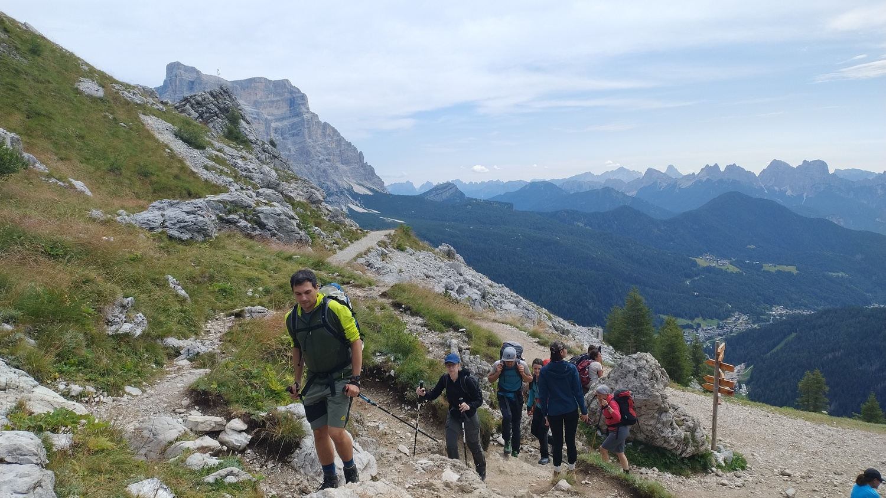

# Hikes

In recent years I have walked a few multi-day hikes in the Dolomites,
and I decided to write about them in this website. These pages are somewhere
between a personal journal of my adventure and a guide for other hikers
who may want to complete similar routes.

* [**Alta Via 2.**](av2)
This is a 160km hiking route with more than 10 000 meters
of altitude gain, going from [Brixen](https://en.wikipedia.org/wiki/Brixen),
in South Tyrol, to [Feltre](https://en.wikipedia.org/wiki/Feltre), the city
where I was born. I completed it in 2025 together with my dad.

* [**The Civetta-Moiazza Ring.**](civetta-moiazza)
In 2026 I hiked a 3-day ring tour of the Civetta-Moiazza group, one of the most
iconic mountains of the
[*Dolomiti Bellunesi*](https://en.wikipedia.org/wiki/Dolomiti_Bellunesi).
The first two legs of this route are part of [Alta Via
1](https://it.wikipedia.org/wiki/Alta_via_n._1).
