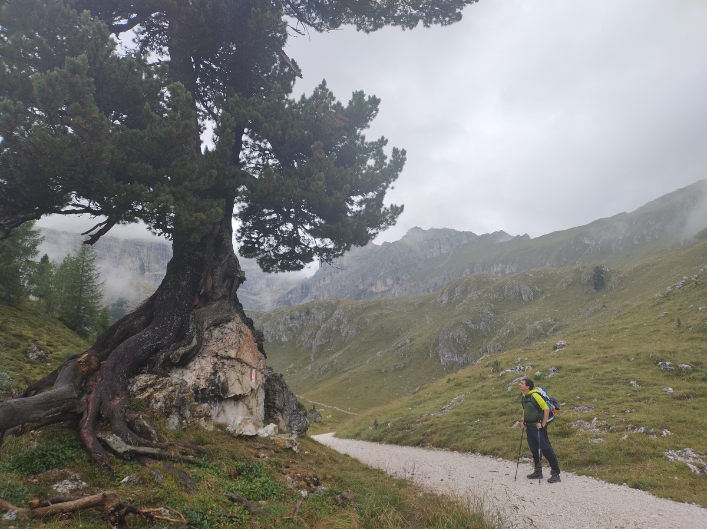

# Sebastiano Tronto

Hello! I am a software developer based in Leiden, The Netherlands.

Previously I was a PhD student in Mathematics at the Universities of
Luxembourg and Leiden. You can check out my [list of papers](research)
and [my talks](talks).

During my free time I enjoy tinkering with my computer, [programming](git)
and playing with the [Rubik's cube](speedcubing).

In the Summer I often return to my hometown in Northern Italy to hike in
the [Dolomites](https://en.wikipedia.org/wiki/Dolomites). For some of my
longer hikes, such as [Alta Via 2](https://en.wikipedia.org/wiki/Alta_Via_2),
I make a dedicated page on the [hiking section](hikes) of this website.
Check it out if you are interested in planning a multi-day hike yourself,
or if you just want to see some beautiful pictures!
